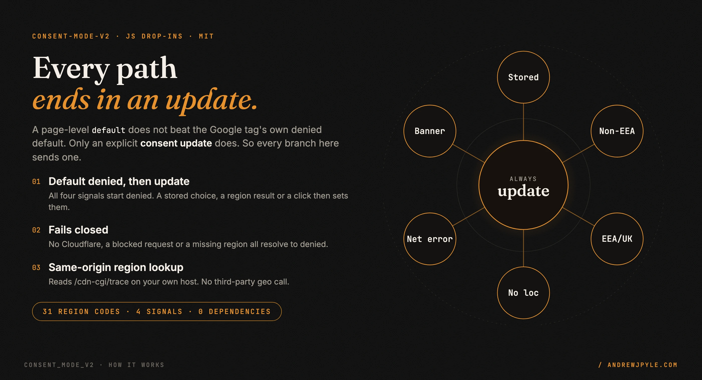
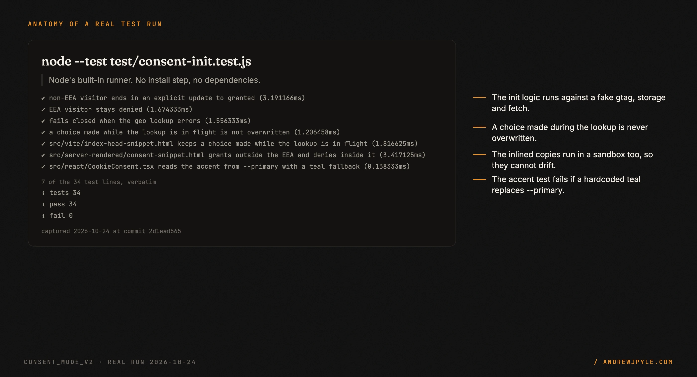
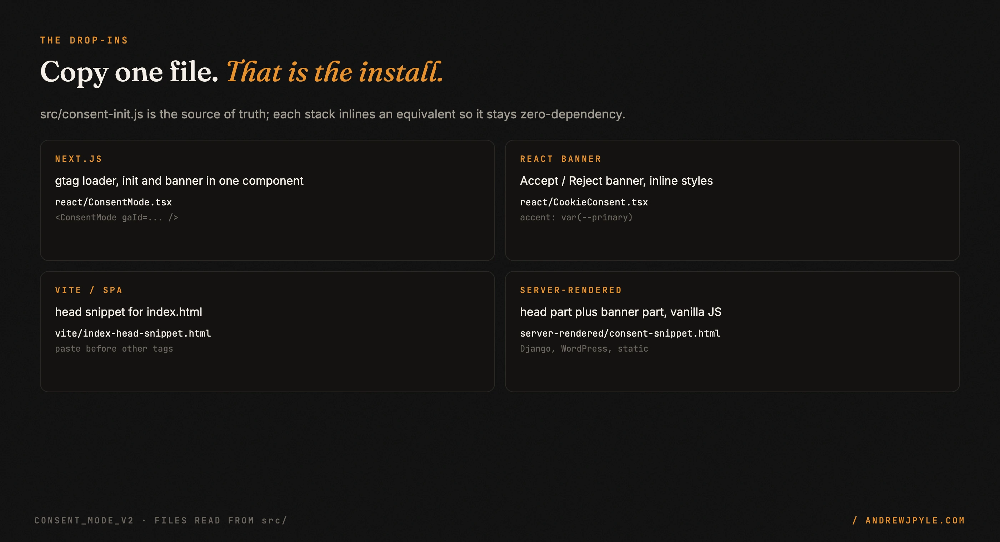
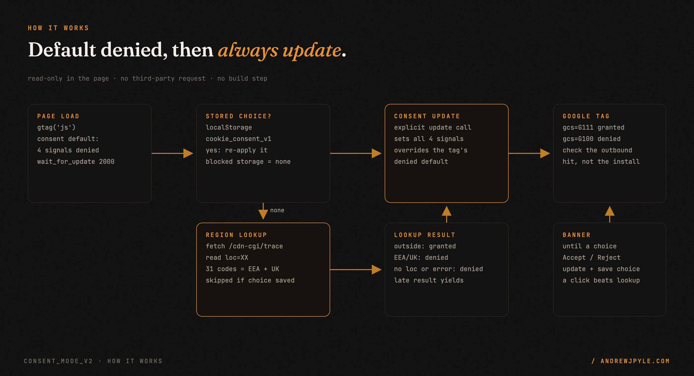

<p align="center">
  
</p>

<p align="center">
  <a href="https://github.com/andrewjpyle/consent_mode_v2/actions/workflows/test.yml"></a>
  
  
  
</p>

# Google Consent Mode v2 drop-ins that cannot silently collect nothing

You add Consent Mode, set a page-level default of `granted`, and watch the consent ping fire. Everything looks plumbed. You collect nothing, with no console error and no failed request. This repo is a dependency-free fix for Next.js, Vite/React SPAs and server-rendered sites (Django, WordPress, Shopify, plain HTML).

- **Four drop-ins**, one per stack. Copy a file out of `src/` and you are done. No build step, no `npm install`.
- **Default denied** for all four consent signals, with `wait_for_update: 2000`.
- **Region from your own host.** It reads Cloudflare's same-origin `/cdn-cgi/trace`. There is no third-party geo call to disclose.
- **Fails closed.** A missing region, a network error or a non-Cloudflare host resolves to `denied`.
- **34 tests** on Node's built-in runner, including sandboxed runs of every inlined init script.

> **The one idea worth stealing, even if you never run this code:** a page-level
> `gtag('consent', 'default', {...})` does not override a Google Tag container's own denied
> default. Only an explicit `gtag('consent', 'update', {...})` does. Before: set `default: granted`
> for visitors outside the EEA and call it done. After: default to `denied`, then end every code
> path, including "no banner needed", in an `update`.

---

## 60 seconds to a passing run

```bash
git clone https://github.com/andrewjpyle/consent_mode_v2
cd consent_mode_v2
npm test
```

You get a run like this (real output, trimmed; Node 20 or newer, no install step):

```text
✔ non-EEA visitor ends in an explicit update to granted
✔ EEA visitor stays denied
✔ fails closed when the geo lookup errors
✔ a choice made while the lookup is in flight is not overwritten
ℹ tests 34
ℹ pass 34
ℹ fail 0
```

<p align="center"></p>

## Install in your app

Copy the file for your stack out of `src/`. That is the install.

<p align="center"></p>

### Next.js (App Router)

```bash
cp src/react/ConsentMode.tsx src/react/CookieConsent.tsx your-app/src/components/
```

```tsx
// app/layout.tsx
import ConsentMode from "@/components/ConsentMode";

export default function RootLayout({ children }) {
  return (
    <html>
      <body>
        {children}
        <ConsentMode gaId={process.env.NEXT_PUBLIC_GA4_ID!} />
      </body>
    </html>
  );
}
```

Pass `adsId="AW-…"` as well if you run Google Ads. If `gaId` is empty the component renders nothing, so a misconfigured build fails visibly instead of falling back to a wrong container.

<details>
<summary><b>Multi-tenant</b> (one Next app serving many domains)</summary>

Resolve the measurement id from the request host in the server layout, then pass it down:

```tsx
import { headers } from "next/headers";

const HOST_TO_GA_ID: Record<string, string> = {
  "example.com":     "G-XXXXXXXXXX",
  "example.co.uk":   "G-YYYYYYYYYY",
};

export default async function RootLayout({ children }) {
  const host = (await headers()).get("host")?.replace(/^www\./, "") ?? "";
  const gaId = HOST_TO_GA_ID[host] ?? "";
  return <html><body>{children}<ConsentMode gaId={gaId} /></body></html>;
}
```
</details>

### Vite / React SPA

1. Paste `src/vite/index-head-snippet.html` into your `index.html` `<head>`, **before any other analytics or ad tag**. Replace `G-XXXXXXXXXX`.
2. Vendor `src/react/CookieConsent.tsx`, set `POLICY_HREF`, and mount it once near your app root.

### Server-rendered (Django / WordPress / Shopify / static)

`src/server-rendered/consent-snippet.html` has two parts: **(A)** into `<head>` before any other tag, **(B)** just before `</body>`. It is vanilla JS. Interpolate the measurement id with your template engine (`{{ ga_id }}`, `<?php echo $ga_id ?>`, `{{ settings.ga_id }}`).

If the site already collects, this is a compliance add (EEA gating), not an analytics fix. Replace the existing gtag init with part (A) and add part (B).

## Configuration

| What | Where | Default |
|---|---|---|
| `localStorage` key | `CONSENT_KEY` in each file | `cookie_consent_v1` |
| EEA/UK region list | `EEA_UK` in `src/consent-init.js` | 30 EEA states + `GB` (31 codes) |
| Privacy-policy link | `POLICY_HREF` in the banner | `/privacy-policy/#cookies` |
| Banner accent | CSS custom property `--primary` | `#43ccad` when `--primary` is not defined |

`src/consent-init.js` is the **source of truth** for behavior. Each per-stack file inlines an equivalent so the drop-in stays zero-dependency. If you change the region list or the key, change it there and re-sync the copies. The tests fail when a copy drifts.

The banners use inline styles, with no Tailwind or theme import. The accept button and the policy link read `var(--primary, #43ccad)`, so a site that defines `--primary` gets its own brand color. If your `--primary` is dark, set a real button color for the banner, because the Accept label is dark text. Want Switzerland treated as EEA? Add `'CH'` to `EEA_UK`.

## How it works

<p align="center"></p>

1. Default all four signals (`ad_storage`, `analytics_storage`, `ad_user_data`, `ad_personalization`) to `denied`.
2. If the visitor already chose, re-apply that choice. No lookup runs.
3. Otherwise read `loc=` from `/cdn-cgi/trace` on your own origin. Outside the EEA/UK sends `granted`. Inside sends `denied` until they accept.
4. Any error resolves to `denied`.
5. If the visitor clicks Accept or Reject while the lookup is in flight, the click wins and the late region result is dropped.

The banner shows to every visitor who has no stored choice, in every region. A visitor outside the EEA is already `granted` and can still reject.

## Verifying it actually works

Do not trust "the tag is installed". Check Google's `gcs` parameter on the outbound hit (values as documented for Consent Mode; the table is not exercised by the tests, which stop at the `consent` call).

| What you did | Expected `gcs` |
|---|---|
| Load from outside the EEA | `G111` (granted) |
| Click **Reject** | `G100` |
| Reload after rejecting | `G100` (persisted) |
| Click **Accept** | `G111` |

The EEA branch cannot be exercised from a non-EEA IP. Mock `/cdn-cgi/trace` to return `loc=DE`, which is what the tests do. `G100` where you expected `G111` usually means the container-default bug above.

## Scope: what it does not do

- **No CMP.** It is a binary Accept/Reject banner, not an IAB TCF consent management platform.
- **Not legal advice.** The EEA/UK list is a default. Check it against your own obligations.
- **Needs Cloudflare for region.** Without `/cdn-cgi/trace` the lookup fails and everyone gets `denied` until they accept. That is a safe degradation. Swap in your own resolver if you want granted-by-default outside the EEA.
- **No per-category choices.** Four signals move together.
- **Not a package.** `package.json` is a test harness. You vendor files by copying.

The measurement id should be injected at build time from your secret store, not committed.

## The patterns

| Pattern | The failure it prevents |
|---|---|
| Every path ends in `consent update` | A page-level default silently losing to the container's denied default, so analytics reads zero |
| Default all four signals denied | Collecting before the visitor or region is known |
| Fail closed on any lookup error | Granting consent because a request was blocked |
| Same-origin region lookup | A third-party geo call you must disclose |
| A saved or clicked choice beats the late region result | Re-granting a visitor who just pressed Reject |
| One source file plus tested inlined copies | The four drop-ins drifting apart on key or region list |

## Tests

`npm test` runs `test/consent-init.test.js` with Node's built-in runner. CI runs it on Node 20, 22 and 24 and fails if fewer than 34 tests pass. The tests cover:

- every branch of `src/consent-init.js` ends in a `consent` `update`, and lookup failures fail closed;
- a choice made during the lookup is not overwritten, for the source and for each inlined copy;
- each inlined init script, run in a Node `vm` sandbox, defaults to denied, grants outside the EEA, denies inside it and re-applies a stored choice;
- the copies share the storage key and EEA/UK list, and the banner accent reads `--primary`.

## FAQ

**Why not just set `default: granted` outside the EEA?** Because the Google Tag container's own default wins over a page-level default. Only an `update` takes effect.

**Does the geo lookup send visitor data to a third party?** No. It is a same-origin request to your own Cloudflare-fronted host.

**Can I use it without React?** Yes. The Vite and server-rendered snippets are plain JS.

## Roadmap

- A region resolver hook for hosts that are not behind Cloudflare.
- Optional per-category choices.

## License

MIT. By [Andrew Pyle](https://andrewjpyle.com). More reusable parts: [autonomousaj.com/parts](https://autonomousaj.com/parts).
